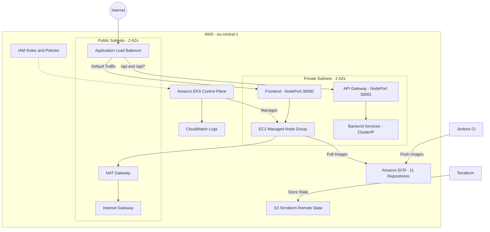

# ApniDukaan - Infrastructure

AWS infrastructure for the ApniDukaan microservices project, provisioned using Terraform.

## Architecture



## AWS Services Used

| Service | Purpose |
|---|---|
| VPC | Isolated AWS network |
| Public Subnets | Host the ALB and NAT Gateway |
| Private Subnets | Host EKS worker nodes |
| Internet Gateway | Internet connectivity |
| NAT Gateway | Outbound internet access |
| Amazon EKS | Managed Kubernetes cluster |
| EC2 Managed Node Group | Runs application workloads |
| Amazon ECR | Stores 11 container repositories |
| Application Load Balancer | Routes traffic to Frontend and API Gateway |
| IAM | Access management and permissions |
| OIDC | IAM integration with Kubernetes service accounts |
| CloudWatch | EKS control plane logs |
| Amazon S3 | Terraform remote state storage |

## Infrastructure Highlights

- Infrastructure provisioned using Terraform.
- EKS worker nodes distributed across two Availability Zones.
- Frontend NodePort: `30080`.
- API Gateway NodePort: `30081`.
- Backend services use ClusterIP.
- Jenkins IAM user has restricted permissions to push images to ECR.
- EKS nodes have permissions to pull images from ECR.
- Terraform state is stored in an encrypted, versioned S3 bucket.
- EKS control plane API, audit, and authenticator logs are enabled.

## Notes

- Dockerfiles and Kubernetes manifests are maintained separately.
- The EKS public API endpoint currently allows access from `0.0.0.0/0`; restrict it to trusted IP addresses before production use.
- A single NAT Gateway is used to reduce development costs.

## Project Structure

```text
infrastructure/
├── README.md
└── terraform/
    ├── bootstrap/
    ├── backend.tf
    ├── cloudwatch.tf
    ├── ecr.tf
    ├── eks-cluster.tf
    ├── iam-eks.tf
    ├── load-balancer.tf
    └── ...
```
